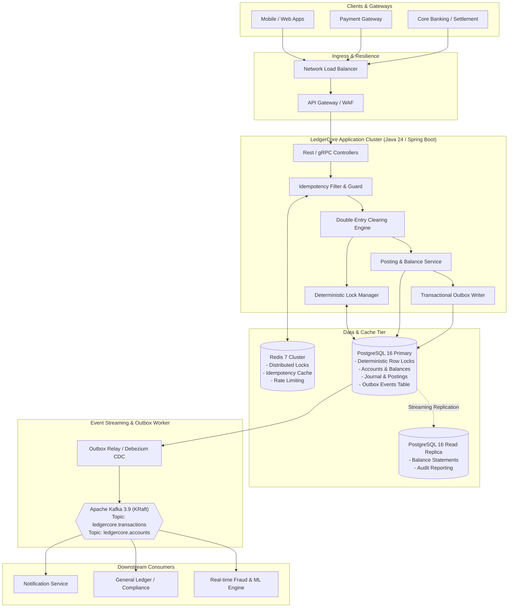
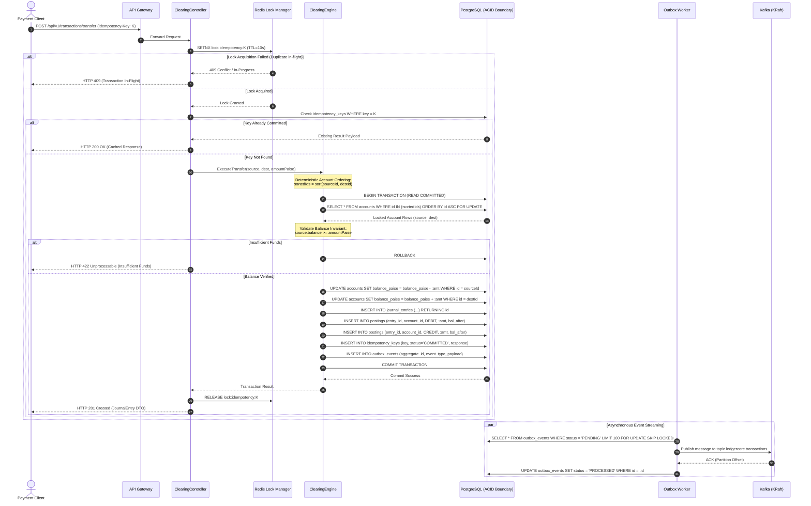
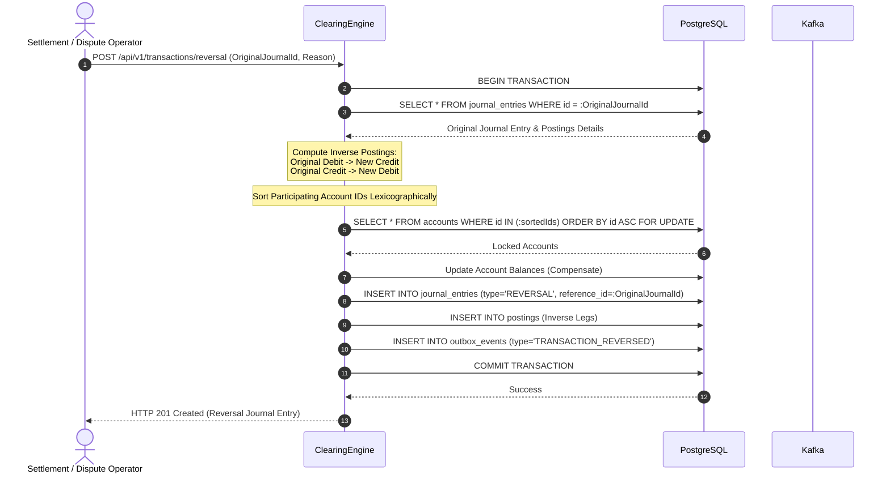
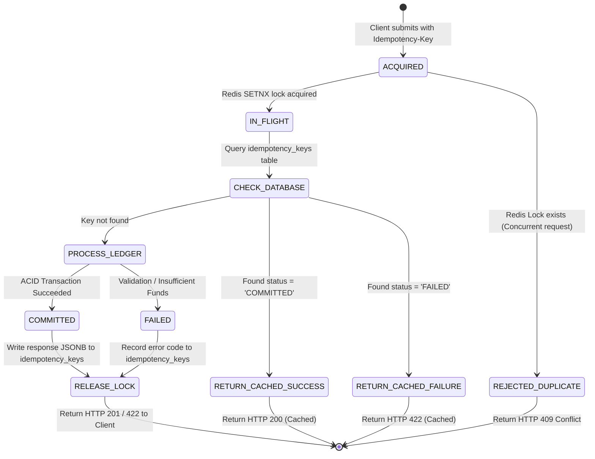

# LedgerCore: High-Performance Double-Entry Payment & Clearing Engine
## Complete System Design & Architectural Specification

---

## 1. Executive Summary & Architectural Goals

**LedgerCore** is an enterprise-grade, real-time Double-Entry Payment & Clearing Engine designed for high-throughput financial infrastructure (e.g., core banking, payment service providers, merchant clearing, and digital wallets). 

The platform guarantees mathematical correctness and strict compliance with the **fundamental equation of accounting**:
$$\Delta \text{Assets} + \Delta \text{Expenses} \equiv \Delta \text{Liabilities} + \Delta \text{Equity} + \Delta \text{Revenue}$$

Every transaction is represented as a balanced journal entry where total debits equal total credits. Money values are modeled exclusively as integer minor currency units (`BIGINT` paise for INR, cents for USD) to eliminate IEEE 754 floating-point inaccuracies.

### Key Architectural Tenets
- **Mathematical Invariant Preservation**: Zero unallocated funds; zero rounding discrepancies; zero phantom balances.
- **Deadlock-Free High Concurrency**: Deterministic lexicographical locking ordering of accounts under pessimistic row locking (`SELECT ... FOR UPDATE`).
- **Distributed Idempotency**: Exactly-once processing guarantee across API retries, network glitches, and client failovers.
- **Strict Host Isolation**: Fully containerized lifecycle powered by Java 24 (Temurin OpenJDK) with generational ZGC, Spring Boot, PostgreSQL 16, Redis 7, and Apache Kafka 3.9 in KRaft mode.

---

## 2. High-Level Architecture

The system decouples synchronous atomic clearance from asynchronous downstream streaming using the **Transactional Outbox Pattern**.



---

## 3. Sequence Diagrams

### 3.1 End-to-End Payment Clearing Flow



---

### 3.2 Compensating Transaction (Reversal / Void) Sequence

Because accounting history is **strictly immutable**, reversals never delete or update existing journal entries or postings. Instead, an inverse compensating journal entry is posted:



---

## 4. Database Schema & Indexing Rationale

### 4.1 Relational Schema (PostgreSQL 16)

```sql
-- Enable cryptographic extensions for UUID v7 / v4 generation
CREATE EXTENSION IF NOT EXISTS "pgcrypto";

-- 1. ACCOUNTS TABLE
CREATE TABLE accounts (
    id UUID PRIMARY KEY DEFAULT gen_random_uuid(),
    account_number VARCHAR(34) NOT NULL UNIQUE, -- Supports IBAN format
    account_type VARCHAR(20) NOT NULL CHECK (account_type IN ('ASSET', 'LIABILITY', 'EQUITY', 'REVENUE', 'EXPENSE')),
    currency CHAR(3) NOT NULL, -- ISO-4217 (e.g., 'INR', 'USD', 'EUR')
    balance_paise BIGINT NOT NULL DEFAULT 0,
    pending_balance_paise BIGINT NOT NULL DEFAULT 0,
    status VARCHAR(20) NOT NULL DEFAULT 'ACTIVE' CHECK (status IN ('ACTIVE', 'FROZEN', 'CLOSED')),
    version BIGINT NOT NULL DEFAULT 0,
    created_at TIMESTAMPTZ NOT NULL DEFAULT CURRENT_TIMESTAMP,
    updated_at TIMESTAMPTZ NOT NULL DEFAULT CURRENT_TIMESTAMP,
    CONSTRAINT chk_positive_balance CHECK (account_type != 'ASSET' OR balance_paise >= 0)
);

-- 2. JOURNAL ENTRIES TABLE (Header for double-entry transactions)
CREATE TABLE journal_entries (
    id UUID PRIMARY KEY DEFAULT gen_random_uuid(),
    idempotency_key VARCHAR(128) NOT NULL UNIQUE,
    entry_type VARCHAR(32) NOT NULL CHECK (entry_type IN ('TRANSFER', 'CLEARING', 'SETTLEMENT', 'FEE', 'REVERSAL')),
    status VARCHAR(20) NOT NULL DEFAULT 'COMMITTED' CHECK (status IN ('COMMITTED', 'REVERSED')),
    description TEXT,
    reference_id UUID, -- References original journal entry if type = 'REVERSAL'
    created_at TIMESTAMPTZ NOT NULL DEFAULT CURRENT_TIMESTAMP
);

-- 3. POSTINGS TABLE (Immutable debit/credit individual legs)
CREATE TABLE postings (
    id UUID PRIMARY KEY DEFAULT gen_random_uuid(),
    journal_entry_id UUID NOT NULL REFERENCES journal_entries(id) ON DELETE RESTRICT,
    account_id UUID NOT NULL REFERENCES accounts(id) ON DELETE RESTRICT,
    direction VARCHAR(6) NOT NULL CHECK (direction IN ('DEBIT', 'CREDIT')),
    amount_paise BIGINT NOT NULL CHECK (amount_paise > 0),
    balance_after_paise BIGINT NOT NULL,
    created_at TIMESTAMPTZ NOT NULL DEFAULT CURRENT_TIMESTAMP
);

-- 4. IDEMPOTENCY KEYS TABLE (Deduplication and cached API results)
CREATE TABLE idempotency_keys (
    key VARCHAR(128) PRIMARY KEY,
    request_hash VARCHAR(64) NOT NULL,
    status VARCHAR(20) NOT NULL CHECK (status IN ('IN_FLIGHT', 'COMMITTED', 'FAILED')),
    response_code INT,
    response_body JSONB,
    locked_until TIMESTAMPTZ NOT NULL,
    created_at TIMESTAMPTZ NOT NULL DEFAULT CURRENT_TIMESTAMP
);

-- 5. TRANSACTIONAL OUTBOX TABLE (Guaranteed event streaming)
CREATE TABLE outbox_events (
    id UUID PRIMARY KEY DEFAULT gen_random_uuid(),
    aggregate_type VARCHAR(64) NOT NULL,
    aggregate_id VARCHAR(128) NOT NULL,
    event_type VARCHAR(64) NOT NULL,
    payload JSONB NOT NULL,
    status VARCHAR(20) NOT NULL DEFAULT 'PENDING' CHECK (status IN ('PENDING', 'PROCESSED', 'FAILED')),
    retry_count INT NOT NULL DEFAULT 0,
    created_at TIMESTAMPTZ NOT NULL DEFAULT CURRENT_TIMESTAMP,
    processed_at TIMESTAMPTZ
);
```

---

### 4.2 Indexing Rationale & Optimization Strategy

1. **Composite Statement Generation Index on Postings**:
   ```sql
   CREATE INDEX idx_postings_account_created 
   ON postings (account_id, created_at DESC) 
   INCLUDE (direction, amount_paise, balance_after_paise);
   ```
   - **Rationale**: Customer statement queries (`SELECT * FROM postings WHERE account_id = ? ORDER BY created_at DESC LIMIT 50`) constitute 70% of read traffic. Using an index with covering columns (`INCLUDE`) enables an **Index-Only Scan**, bypassing heap fetches completely.

2. **Journal Grouping Index**:
   ```sql
   CREATE INDEX idx_postings_journal_entry_id 
   ON postings (journal_entry_id);
   ```
   - **Rationale**: Reconstructing the complete double-entry transaction voucher requires joining `postings` on `journal_entry_id`. This prevents a sequential scan across billions of historical postings.

3. **Partial Index on Active Outbox Events**:
   ```sql
   CREATE INDEX idx_outbox_pending 
   ON outbox_events (created_at ASC) 
   WHERE status = 'PENDING';
   ```
   - **Rationale**: The outbox worker constantly polls for `status = 'PENDING'`. Once processed, records become cold. A partial index keeps the working index size minuscule (typically a few thousand rows), fitting entirely inside L3 CPU cache / RAM.

4. **Idempotency Expiry Index**:
   ```sql
   CREATE INDEX idx_idempotency_locked_until 
   ON idempotency_keys (locked_until) 
   WHERE status = 'IN_FLIGHT';
   ```
   - **Rationale**: Allows instant background harvesting of orphaned or timed-out in-flight locks.

5. **Table Partitioning for Long-Term Scale**:
   - `postings` can be declaratively partitioned by **range of `created_at`** (e.g., monthly partitions):
     ```sql
     CREATE TABLE postings_2026_11 PARTITION OF postings
     FOR VALUES FROM ('2026-11-01 00:00:00+00') TO ('2026-12-01 00:00:00+00');
     ```
   - Eliminates index bloat and enables zero-downtime archival via `DETACH PARTITION`.

---

## 5. Capacity Estimation & Performance Sizing

### 5.1 Volume & Throughput Metrics

| Parameter | Nominal Value | Peak Value |
|---|---|---|
| Daily Transactions | 10,000,000 tx/day | 30,000,000 tx/day |
| Active Clearing Window | 16 hours / day | Peak burst (1 hour) |
| Average Throughput | $\approx$ 174 TPS | $\approx$ 5,000 TPS |
| Peak Stress Throughput | 5,000 TPS | **15,000 TPS** |
| Postings generated per Tx | 2 legs (1 Debit, 1 Credit) | 4 legs (Multi-split) |

---

### 5.2 Storage Sizing Model

1. **Record Sizes**:
   - `journal_entries`: ~200 bytes/row
   - `postings`: ~150 bytes/row $\times$ 2 = 300 bytes/tx
   - `idempotency_keys`: ~250 bytes/row (pruned after 7 days)
   - `outbox_events`: ~400 bytes/row (pruned after 7 days)
   - **Total raw row size per transaction**: $\approx 500$ bytes.

2. **Daily Ingestion**:
   $$\text{Daily Raw Data} = 10{,}000{,}000 \times 500 \text{ B} = 5.0 \text{ GB / day}$$
   $$\text{Daily Index & WAL Overhead} (\approx 45\%) = 2.25 \text{ GB / day}$$
   $$\text{Total Daily Storage} \approx 7.25 \text{ GB / day}$$

3. **Yearly Capacity Requirement**:
   $$\text{Yearly Storage} = 7.25 \text{ GB / day} \times 365 = 2.646 \text{ TB / year}$$
   Factoring in 3x hot storage replication: $\approx \mathbf{8.0\text{ TB / year}}$.

---

### 5.3 Memory & Cache Sizing

- **Working Set (Pareto 80/20 Rule)**:
  - 80% of daily transactions hit 20% of accounts (merchant accounts, clearing omnibus pools, active users).
  - Active Accounts: 10M total accounts $\times 20\% = 2\text{M active accounts}$.
  - Memory per account row in PostgreSQL: $\approx 250$ bytes.
  - Active account cache working set: $2\text{M} \times 250\text{ B} = \mathbf{500\text{ MB}}$.
- **PostgreSQL Buffer Pool (`shared_buffers`)**:
  - Sized at 16 GB to 32 GB RAM, keeping all hot indexes and recent postings in memory.
- **Redis 7 Memory Sizing**:
  - Distributed locks: 50,000 concurrent locks $\times 256$ B = 12.8 MB.
  - Idempotency TTL cache (24 hours): $10\text{M keys} \times 500$ B $\approx 5.0$ GB RAM.
  - Total Redis footprint: Provision **8 GB to 16 GB RAM**.

---

### 5.4 Network Bandwidth & Disk IOPS

- **Network Ingress / Egress**:
  - $15{,}000 \text{ TPS} \times 1.5 \text{ KB payload} \approx 22.5 \text{ MB/sec} = \mathbf{180 \text{ Mbps}}$ (Well within standard 10 Gbps cloud NIC limits).
- **Disk IOPS Requirement**:
  - PostgreSQL Write-Ahead Log (WAL) sync on commit:
  - Under group commit (`commit_delay`), 15,000 TPS requires $\approx \mathbf{10{,}000\text{ to }20{,}000\text{ IOPS}}$ on NVMe enterprise SSDs (AWS gp3 / io2 or NVMe Direct-Attached Storage).

---

## 6. CAP & Consistency Tradeoffs

### 6.1 PACELC Theorem Classification

The PACELC theorem extends CAP by addressing latency vs. consistency in the absence of partitions:
$$\text{If Partition }(P) \rightarrow \text{Trade Availability }(A)\text{ or Consistency }(C); \quad \text{Else }(E) \rightarrow \text{Trade Latency }(L)\text{ or Consistency }(C)$$

> **LedgerCore is classified as PC/EC:**
> - In the event of a network partition (**P**), the system chooses **Consistency (C)** over Availability (A). It rejects transactions rather than risking split-brain or double-spending.
> - Under normal non-partitioned operation (**E**), the system chooses **Consistency (C)** over Latency (L). It insists on synchronized ACID commits and deterministic row locks before acknowledging clients.

```
       CAP / PACELC Decision Matrix
┌──────────────────────────────────────────────┐
│  High Availability (AP)                      │
│  e.g., Social Media Feeds, Shopping Carts    │
│  [Eventual Consistency, Double-Spend Risk]   │
├──────────────────────────────────────────────┤
│  LedgerCore Choice: Strong Consistency (CP)  │
│  e.g., Central Bank RTGS, Double-Entry Core  │
│  [Synchronous Lock, Zero Financial Drift]    │
└──────────────────────────────────────────────┘
```

---

### 6.2 ACID Core vs. BASE Edge

| Domain Boundary | Model | Guarantees | Mechanism |
|---|---|---|---|
| **Clearing & Balances** | **ACID** | Atomicity, Consistency, Isolation, Durability | PostgreSQL 16, Row Locks, WAL `fsync` |
| **Audit & Outbox Stream** | **At-Least-Once** | Reliable delivery, zero message drop | Outbox Polling + Kafka Producer ACKs |
| **Downstream Analytics** | **BASE** | Eventual consistency, asynchronous catchup | Kafka Consumers, Read Replicas, ClickHouse |

---

### 6.3 Concurrency Control: Pessimistic vs. Optimistic

| Strategy | Contention Behavior | Fit for LedgerCore |
|---|---|---|
| **Optimistic Concurrency Control (OCC)** (e.g. `@Version`) | High abort/retry storm when multiple transactions hit a popular merchant or fee pool account. | ❌ Unsuitable: At 5,000 TPS hitting a single clearing account, 98% of OCC transactions fail and trigger retry storms. |
| **Pessimistic Locking (`SELECT FOR UPDATE`)** | Threads queue cleanly on the row lock; predictable latency; zero wasted compute from abort loops. | ✅ **Selected Choice**: Deterministic order sorting eliminates deadlock hazard. |

---

## 7. Idempotency State Machine

Every financial transaction mutates balances permanently. Network timeouts, retry storms, or gateway crashes must never duplicate a payment.



### Idempotency Key Semantics
1. **Hash Verification**: The stored record contains `request_hash = SHA256(payload)`. If a request arrives with an existing key but differing payload, it is rejected with `HTTP 422 Unprocessable Entity (Idempotency Key Payload Mismatch)`.
2. **Lock Expiration (TTL)**: Redis distributed locks carry a 10-second TTL. If a node crashes mid-transaction, PostgreSQL rolls back uncommitted rows automatically, and the lock expires, allowing safe automated retry.

---

## 8. Failure Modes & Mitigations

### 8.1 Deadlock Prevention (The Dining Bankers Problem)
- **Failure Mode**: Thread 1 locks Account A then wants Account B; Thread 2 locks Account B then wants Account A. PostgreSQL detects circular wait and aborts one transaction.
- **Mitigation**: **Strict Lexicographical Lock Ordering**.
  Before acquiring row locks, all account IDs are sorted:
  $$\text{ID}_1 < \text{ID}_2 < \dots < \text{ID}_n$$
  Because all threads request locks in identical order, circular wait graphs are mathematically impossible.

### 8.2 Double Spending Prevention
- **Failure Mode**: Two simultaneous requests debit Account A when balance is 10,000 paise (Tx 1 debits 8,000; Tx 2 debits 6,000).
- **Mitigation**:
  1. `SELECT ... FOR UPDATE` row lock serializes reads and balance evaluations.
  2. Database constraint: `CONSTRAINT chk_positive_balance CHECK (balance_paise >= 0)`. Any attempt to overdraw immediately triggers a constraint violation exception and rolls back the transaction.

### 8.3 The Dual-Write Problem (Database vs. Kafka)
- **Failure Mode**: Database commit succeeds, but network partition occurs before Kafka publish $\rightarrow$ Event lost. Or Kafka publish succeeds, but DB commit fails $\rightarrow$ Phantom event published.
- **Mitigation**: **Transactional Outbox Pattern**.
  The application writes exclusively to PostgreSQL. The domain event is saved to the `outbox_events` table inside the same transaction. A separate relay worker publishes to Kafka with ACK `all`, guaranteeing at-least-once streaming.

### 8.4 Kafka Poison Pill & Consumer Crashes
- **Failure Mode**: Malformed event crashes downstream consumer repeatedly, stalling the consumer group partition offset.
- **Mitigation**:
  - **Dead Letter Queue (DLQ)** pattern with retry topic hierarchy (`ledgercore.transactions.retry-1`, `ledgercore.transactions.retry-2`, `ledgercore.transactions.dlq`).
  - Strict exponential backoff before sending unprocessable messages to DLQ for manual inspection.

### 8.5 Split-Brain Prevention
- **PostgreSQL**: Managed cluster utilizing Patroni / Raft consensus with synchronous standby replication (`synchronous_commit = on`).
- **Apache Kafka 3.9 (KRaft)**: KRaft quorum controller nodes replace legacy ZooKeeper, enforcing single-leader raft log replication with zero split-brain ambiguity.

---

## 9. Technology Stack & Verification Matrix

| Layer | Component | Version | Role |
|---|---|---|---|
| Language Runtime | Eclipse Temurin OpenJDK | Java 24 | Generational ZGC, Virtual Threads, Records |
| Build Tool | Apache Maven | 3.9 | Build, dependency cache, test runner |
| Relational Storage | PostgreSQL | 16-alpine | ACID ledger, row locking, JSONB outbox |
| In-Memory Engine | Redis | 7-alpine | Distributed lock, fast idempotency lookup |
| Event Backbone | Apache Kafka (KRaft) | 3.9.0 | Scalable at-least-once event streaming |
| Container Orchestration | Docker Compose | v2+ | Isolated zero-host-install environment |
